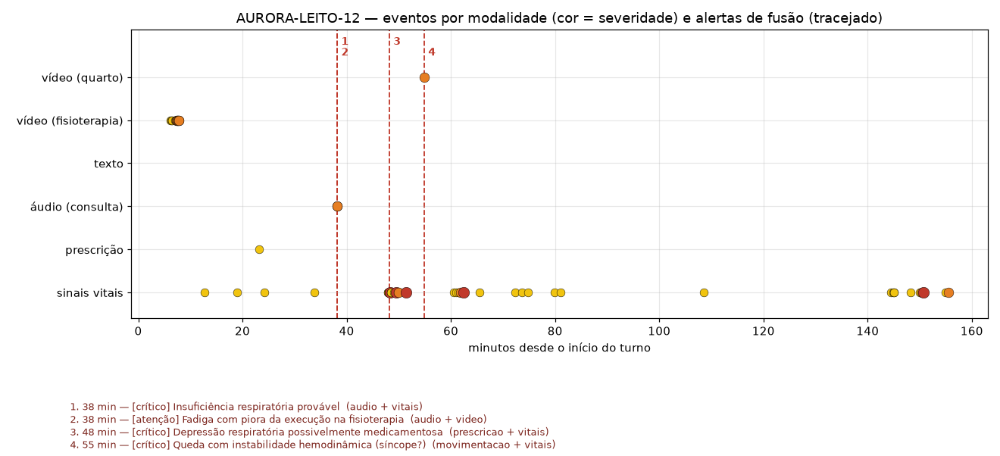
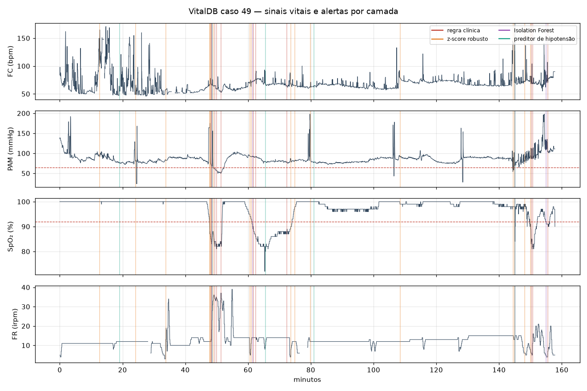

# Relatório Técnico — FASE 4: Monitoramento Multimodal com Detecção de Anomalias

**Tech Challenge · Pós-graduação em IA para Devs (FIAP)**
Jeferson Verdan Oliveira — RM370792 · Outubro de 2026

---

## 1. Problema e visão geral

O Hospital Aurora já tinha modelos preditivos (Fases 1–2) e um assistente com LLM (Fase 3). Nesta
fase, ele passa a **monitorar o paciente continuamente** com quatro tipos de dado: sinais vitais,
prescrições, áudio de consultas e vídeo (fisioterapia e quarto). O objetivo é detectar sinais
precoces de risco e alertar a equipe.

A decisão de arquitetura central vem da Fase 3: **os modelos detectam, as regras decidem.** Cada
detector (visão computacional, fala, *machine learning*) produz um `Evento` padronizado com a
origem, o tipo, a severidade, o instante, a descrição e as evidências. Só o **motor de fusão**
(`monitor/fusion/motor.py`), que é código determinístico, transforma eventos em **alertas**. Isso
torna cada alerta explicável ("por que tocou?") e auditável ("quem foi avisado, quando, com base
em quê").

Todos os dados vêm de **datasets públicos**. Nenhum dado de paciente real identificável foi usado.

## 2. Fluxo multimodal

```
                         ┌──────────────────────── Evento (origem, tipo, severidade, t, evidências) ───┐
 VitalDB / MIMIC ─► limpeza de artefatos ─► regras sustentadas · z-score robusto ·                      │
                                            Isolation Forest · preditor de hipotensão · NEWS2           │
 MIMIC (prescrições) ─► salto de dose · dose atípica · instabilidade · combinações perigosas            │
 PriMock57 ─► Azure Speech (STT) ─► Azure Text Analytics for Health + sentimento ─► sinais de alarme    ├─► Motor de fusão ─► Alerta ─► painel · webhook · auditoria
          └► trechos de fala ─► marcadores acústicos + wav2vec 2.0 ─► modelos de voz (calibrados)       │   (regras + escore)
 REHAB24-6 ─► YOLOv8-pose / OpenPose ─► ângulos ─► repetições ─► desvio do padrão esperado ─► relatório  │
 UR Fall ─► YOLOv8-pose + YOLOv8 (leito = zona segura) ─► queda · imobilidade                           │
                                                                                                        ┘
```

1. **Ingestão e normalização.** Cada fonte é convertida para um formato canônico: canais de sinais
   vitais (`HR, SPO2, SBP, DBP, MAP, RR, TEMP`), 17 pontos-chave COCO por quadro de vídeo, e
   segmentos de fala com tempo e texto.
2. **Detecção por modalidade.** Detectores *streaming* recebem uma amostra ou um quadro por vez. O
   mesmo código roda em lote (experimentos) e ao vivo (dashboard).
3. **Fusão.** O motor recebe os eventos em ordem temporal e faz três coisas:
   - transforma eventos de severidade "atenção" ou maior em alertas, suprimindo repetições por 15 min;
   - aplica **6 regras de correlação entre modalidades**;
   - mantém um **escore de risco** por paciente: soma das severidades com meia-vida de 30 min e bônus por modalidades distintas ativas.
4. **Entrega.** Cada alerta vai para o painel, para um webhook (formato de *incoming webhook* do
   Teams/Slack) quando a severidade é "urgente" ou maior, e para uma trilha de auditoria JSONL
   *append-only*. O alerta carrega justificativa, ação sugerida, destinatários e prazo:

   | Severidade | Destinatários | Prazo |
   | --- | --- | --- |
   | Atenção | enfermagem | 60 min |
   | Urgente | + médico plantonista | 15 min |
   | Crítico | + time de resposta rápida | imediato |

### 2.1 Integração com Azure e troca de conta

| Serviço gerenciado | Uso | Módulo |
| --- | --- | --- |
| **Azure AI Speech — Speech to Text** | Transcrição contínua das consultas, com tempo por palavra e confiança | `monitor/azure/speech.py` |
| **Azure AI Language — Text Analytics for Health** | Sintomas, diagnósticos, medicamentos, dosagens, **negação** (`certainty`), códigos UMLS e relações | `monitor/azure/language.py` |
| **Azure AI Language — Sentiment + Opinion mining + Key phrases** | Sofrimento ou ansiedade na fala do paciente e tópicos da consulta | `monitor/azure/language.py` |

A conta Azure disponível expira em poucos dias. Por isso, a integração foi desenhada para ser
**trocável e reprodutível**:

- **Configuração.** As credenciais ficam só no `.env`. O script `scripts/azure_setup.ps1` (ou `.sh`)
  cria o grupo e os dois recursos na assinatura logada no Azure CLI e grava as chaves.
- **Troca de conta.** É `az login` mais um comando.
- **Cache.** Toda resposta é normalizada e gravada em `data/azure_cache/`, com chave = hash do
  **conteúdo** (áudio ou texto) + operação + idioma, sem depender de conta ou região. O cache é
  versionado no git: quem clona o repositório reproduz os resultados sem conta Azure.
- **Modos (`AZURE_MODE`).** Em `replay`, a demonstração usa as respostas reais já obtidas mesmo
  depois que a assinatura expirar. Em `auto`, o sistema cai em fallbacks locais:
  - a transcrição manual do próprio dataset ou `faster-whisper`;
  - um léxico bilíngue de sintomas com detecção de negação.

**Por que a detecção de anomalias não usa o Azure Anomaly Detector:** o serviço foi descontinuado
pela Microsoft (aposentadoria anunciada para outubro de 2026). Por isso, toda a detecção de
anomalias é local, com scikit-learn e regras. Isso também a mantém auditável e sem custo por
chamada.

## 3. Dados

| Modalidade | Dataset | Recorte usado | Licença |
| --- | --- | --- | --- |
| Sinais vitais contínuos | VitalDB (Lee et al., 2022; PhysioNet) | 100 cirurgias (anestesia geral, ≥ 2 h, PA invasiva), amostradas a cada 2 s: **70 treino / 30 teste** | open access |
| Sinais vitais horários + prescrições | MIMIC-IV Clinical Database Demo v2.2 | 100 pacientes, 140 internações em UTI, 12.965 prescrições terapêuticas | ODbL |
| Consultas | PriMock57 (Papadopoulos Korfiatis et al., ACL 2022) | 11 consultas (8 com queixa respiratória, cardíaca, neurológica ou de fadiga + 3 controles), canal do paciente | pesquisa |
| Disartria | TORGO (Rudzicz et al., 2012) | 400 gravações, 15 falantes (8 com disartria, 7 controles) | pesquisa |
| Respiração/fadiga | Coswara (Bhattacharya et al., 2023) | 429 participantes, contagem de 1 a 20 | CC BY 4.0 |
| Fisioterapia | REHAB24-6 (Černek et al., SISAP 2024) | Exercícios 1 (abdução do braço) e 6 (agachamento), 22 vídeos, 373 repetições rotuladas certo/errado, *motion capture* 2D | CC BY-NC 4.0 |
| Movimentação | UR Fall Detection (Kwolek & Kepski, 2014) | 30 quedas + 40 atividades normais, com rótulos por quadro | pesquisa |

## 4. Modelos aplicados e resultados

### 4.1 Sinais vitais (VitalDB, 30 cirurgias de teste, 116 h)

**Camadas** (`monitor/vitals/detectores.py`, `predicao.py`):

| Camada | Técnica | Papel |
| --- | --- | --- |
| Limpeza | Faixas fisiológicas; PAS < PAD = artefato; *forward fill* ≤ 30 s | Não alertar artefato de sensor |
| Regra clínica | Limiares **sustentados**: PAM < 65 por ≥ 60 s; SpO₂ < 92 por ≥ 30 s; FC > 120 ou < 45 por ≥ 60 s… | Decide severidade (urgente/crítico) |
| Estatística | **z-score robusto** (mediana/MAD) dos últimos 30 s contra os 10 min anteriores do *próprio paciente*, com persistência de 2 passos | Mudanças abruptas dentro da faixa normal |
| ML não supervisionado | **Isolation Forest** sobre janelas de 60 s, com features relativas ao paciente (z, tendência e variabilidade de 6 canais) | Combinações atípicas |
| ML supervisionado | **Gradient Boosting**: probabilidade de hipotensão sustentada **começar nos próximos 10 min** | Alerta antes do alarme |
| Enfermaria/UTI | **NEWS2** (Royal College of Physicians), com histerese de 6 h | Deterioração em dados horários (MIMIC) |

**Preditor de hipotensão.** Teste com 11.107 amostras e prevalência de 8,4%:

| Modelo | AUROC | AUPRC |
| --- | --- | --- |
| Gradient Boosting (profundidade 2) | **0,788** | 0,258 |
| *Baseline*: só a PAM atual | 0,753 | 0,274 |

No limiar escolhido no treino (sensibilidade-alvo de 80%), o modelo teve sensibilidade de 72,9%,
especificidade de 74,1% e VPP de 20,4%. As features mais importantes (permutação) foram a PAM
mínima dos últimos 5 min, a PAM atual e a fração do tempo com PAM < 70.

*Leitura crítica:* o ganho sobre a PAM atual é modesto na AUROC e nulo na AUPRC. Isso reproduz o
achado da literatura sobre o *Hypotension Prediction Index* (Enevoldsen & Vistisen, 2022): boa
parte do "poder preditivo" vem do próprio nível de pressão. Árvores rasas generalizaram melhor
entre pacientes que árvores profundas (AUROC 0,72 com profundidade livre).

**Antecipação em dados reais.** Para cada **episódio-índice** confirmado por regra (44 episódios
urgentes ou críticos sem outro episódio nos 30 min anteriores; 32 de hipotensão), verificamos se
alguma camada alertou nos 15 min anteriores ao alarme da regra:

| Camada | Episódios antecipados | Antecedência mediana | Alertas/h | Alertas "sem desfecho"/h |
| --- | --- | --- | --- | --- |
| z-score robusto | 25/44 (57%) | 5,5 min | 3,16 | 2,44 |
| Preditor de hipotensão | 22/32 (69%) | 4,0 min | 1,89 | 1,32 |
| Isolation Forest | 6/44 (14%) | 1,0 min | 0,44 | 0,31 |
| **Qualquer camada** | **36/44 (82%)** | **6,0 min** | 5,49 | 4,08 |

**Injeção sintética.** Para ter *ground truth* conhecido, injetamos anomalias realistas em trechos
estáveis dos casos de teste (28 de cada tipo). A tabela mostra a taxa de detecção em até 10 min:

| Anomalia injetada | Regra | z-score | IForest | Preditor | Qualquer | Atraso mediano (qualquer) |
| --- | --- | --- | --- | --- | --- | --- |
| Dessaturação progressiva (−12 pts em 5 min) | 100% | 100% | 11% | 25% | **100%** | 132 s (regra sozinha: 232 s) |
| Hipotensão progressiva (−35% em 8 min) | 79% | 50% | 7% | 61% | **100%** | 221 s (regra sozinha: 320 s) |
| Taquicardia súbita (+35 bpm) | 7% | 79% | 4% | 25% | **86%** | 42 s |
| Choque compensado (FC +25, PAS −18%) | 25% | 89% | 4% | 32% | **100%** | 162 s |
| **Controle (sem injeção)** — falso alarme | 0% | 29% | 0% | 18% | **43%** | — |

**Conclusões:**

1. As camadas são complementares. A regra é específica, mas tardia e cega para mudanças dentro da
   faixa normal. O z-score pega mudanças abruptas, e o preditor antecipa a hipotensão em cerca de
   100 s.
2. O **Isolation Forest teve desempenho fraco** neste domínio. No intraoperatório, a variação
   "normal" (bolus de drogas, estímulo cirúrgico) tem caudas muito pesadas: o percentil 99 do
   maior z em janelas sem violação de regra é cerca de 11. Assim, um desvio de 5–8 desvios
   robustos não se destaca. Testamos também um envelope elíptico (Mahalanobis robusta), sem
   ganho. O IForest ficou como camada de baixíssima carga (0,44 alertas/h).
3. O custo é a **carga de alarmes**: 43% dos trechos-controle de 10 min tiveram algum alerta
   precoce, sobretudo do z-score em variações fisiológicas reais. É por isso que as camadas
   precoces só emitem "atenção" e quem escala para "urgente" ou "crítico" são as regras e a fusão.

**NEWS2 no MIMIC-IV (140 internações de UTI, 515 pacientes-dia).** O NEWS2 máximo nas primeiras
24 h discriminou a mortalidade hospitalar com AUROC de 0,70 (20 óbitos; mediana 11 nos óbitos vs.
9 nos sobreviventes). Com histerese de 6 h, foram 4,5 alertas por paciente-dia. É alto, como
esperado para uma UTI (o NEWS2 foi desenhado para enfermaria).

### 4.2 Prescrições (MIMIC-IV demo)

`monitor/prescricoes.py`. Foram excluídos os itens não terapêuticos (soros, *flush*) e os
protocolos **reativos por desenho** (reposição de eletrólitos, insulina por escala), cuja dose
muda sempre. Medicamentos de alta vigilância (lista ISMP) sobem um nível de severidade.

| Detector | Técnica | Exemplo real detectado |
| --- | --- | --- |
| Salto de dose | Razão entre prescrições consecutivas do mesmo fármaco/via/unidade × alta vigilância | "Aumento de 3,0× na dose de Heparin (SC): 5.000 → 15.000 UNIT/dia — alta vigilância" (crítico) |
| Dose atípica | z robusto em escala log contra a distribuição hospitalar do fármaco | "Furosemide 160 mg/dia é 8× a mediana hospitalar" |
| Instabilidade | ≥ 4 mudanças de dose em 48 h | "4 mudanças de dose de HYDROmorphone em 48 h" |
| Combinação perigosa | Dois anticoagulantes ativos; opioide + benzodiazepínico (alerta de caixa-preta da FDA) | "Fentanyl + Midazolam ativos — risco de depressão respiratória" |

A primeira versão, que assumia frequência = 1 quando o campo faltava, gerou 2.669 eventos (10,7
por internação), quase todos falsos. Depois das correções (comparar por dose quando a frequência
falta; excluir protocolos reativos; matriz razão × alta vigilância), caiu para **840 eventos (3,4
por internação)**, dominados por "atenção".

### 4.3 Áudio

**Pipeline de consulta** (`monitor/audio/consulta.py`):

1. Azure Speech transcreve o canal do paciente.
2. Azure Text Analytics for Health extrai as entidades.
3. Entidades **não negadas** são agrupadas em 11 sinais de alarme por expressão regular sobre o
   texto e o nome normalizado UMLS (dor torácica, dispneia, síncope, déficit neurológico, fala
   arrastada, hemoptise, risco de suicídio…). Combinações (dor torácica + dispneia) escalam para
   crítico.
4. Em paralelo, os **trechos de fala do paciente** (segundo os tempos do STT) passam pelos
   marcadores acústicos e pelos modelos de voz.

**Marcadores acústicos** (`monitor/audio/acustica.py`, Praat/parselmouth + librosa):

- fonte glótica: jitter, shimmer, HNR e **CPPS**;
- prosódia: F0 e variabilidade em semitons;
- fluência: taxa de fala e de articulação por núcleos silábicos (de Jong & Wempe, 2009), pausas por
  minuto, duração de pausa e comprimento de frase;
- energia: intensidade e sua tendência (queda = fadiga vocal);
- espectro: 13 MFCC.

**Representação auto-supervisionada** (`monitor/audio/embeddings.py`): **wav2vec 2.0 base**
congelado, com média temporal da camada 6 (768 dimensões) e classificador linear.

| Tarefa | Dataset e protocolo | Marcadores clássicos | wav2vec 2.0 | Escolhido |
| --- | --- | --- | --- | --- |
| **Disartria** | TORGO, CV agrupada **por falante** (15 falantes) | AUROC 0,56 | **0,77** (gravação) · **0,91** (falante) | wav2vec 2.0 |
| **Dificuldade respiratória** | Coswara 2021, controle = quem não relatou o sintoma | 0,66 | 0,68 | marcadores + wav2vec: **0,68** |
| **Fadiga** | idem | 0,62 | 0,62 | marcadores + wav2vec: **0,64** |

Os marcadores clássicos mostram diferenças coerentes com a clínica:

- **Disartria:** menor proporção de fonação (0,58 vs. 0,99) e menor CPPS (7,6 vs. 9,9 dB, voz mais
  soprosa).
- **Dificuldade respiratória:** pausas mais longas (0,55 vs. 0,45 s), frases mais curtas (1,03 vs.
  1,14 s) e **intensidade caindo** ao longo da contagem (−2,2 vs. +1,2 dB/min).

**Três armadilhas metodológicas encontradas e corrigidas:**

1. **Vazamento de falante (TORGO).** Sem validar por falante, o classificador aprende a reconhecer
   as 15 pessoas. Toda a validação usa `GroupKFold` por falante.
2. **Confusão por lote (Coswara).** Os participantes com sintomas vêm dos lotes de 2021 e os
   saudáveis, sobretudo, de abril/2020. O **lote é previsível pelo áudio com AUROC de 0,85**
   (aparelho, versão do app). O protocolo ingênuo (sintomático 2021 × saudável 2020) dá AUROC de
   **0,89 para a respiração, mas mede o lote, não o sintoma**. O protocolo oficial usa só os lotes
   de 2021 e, como controle, todos os participantes sem o sintoma, o que cai para **0,68**.
3. **Mudança de domínio de gravação.** O modelo de disartria, treinado no TORGO (microfones de
   laboratório), marcou como disárticos **10 dos 11 pacientes saudáveis do PriMock57** e **31 dos
   36 saudáveis do Coswara**. Implementamos uma **calibração de domínio por alinhamento de média**
   (`ModeloVoz.calibrar_dominio`): as features do domínio novo são deslocadas para que falantes
   **saudáveis** desse domínio fiquem, em média, onde estavam os controles do treino. Isso só exige
   gravações de pessoas sem a condição, que um hospital consegue coletar. Avaliado deixando-um-fora
   (o falante nunca entra na própria referência), os falsos positivos caíram de **10/11 → 0/11**
   (PriMock57) e **31/36 → 1/36** (Coswara). A sensibilidade fora do domínio não pôde ser medida,
   porque esses datasets não têm pacientes com disartria. Fica registrado como limitação.

**Consultas do PriMock57** (11 consultas, canal do paciente):

Pipeline completo com **Azure Speech** (`en-GB`, reconhecimento contínuo) e **Azure Text Analytics
for Health**. A tabela compara os sinais de alarme detectados com a queixa principal; o WER é o da
transcrição do Azure contra a transcrição manual do dataset:

| Consulta | Queixa principal | Esperado | Detectado (Azure) | WER |
| --- | --- | --- | --- | --- |
| day1_consultation06 | "hard to breathe" | dispneia | **dispneia**, dor torácica | 23% |
| day2_consultation04 | "I feel breathless" | dispneia | **dispneia**, hemoptise, fadiga | 32% |
| day2_consultation06 | "difficulty breathing" | dispneia | **dispneia** | 22% |
| day2_consultation07 | "chest discomfort" | dor torácica | **dor torácica**, dispneia | 20% |
| day2_consultation09 | "I can't move my left arm" | déficit neurológico | **déficit neurológico (crítico)** | 21% |
| day3_consultation03 | "no appetite or energy" | fadiga | **fadiga** (*malaise*), dispneia, dor torácica | 26% |
| day5_consultation09 | "Tired all the time" | fadiga | **fadiga** | 21% |
| day4_consultation06 | (metadado errado, ver abaixo) | nenhum | nenhum | 18% |
| day1_consultation02 | pele | nenhum | nenhum | 17% |
| day1_consultation09 | dor ao urinar | nenhum | nenhum | 18% |
| day5_consultation03 | ansiedade | nenhum | fadiga, palpitação | 15% |

- **Queixa principal encontrada em 7/7 consultas**, contra 6/8 com o fallback local (transcrição
  manual + léxico). **WER médio do Azure Speech: 21,2%**, em áudio de teleconsulta e inglês
  britânico com sotaques variados.
- Os sinais "extras" foram conferidos na transcrição manual e **foram de fato relatados pelo
  paciente**, só não eram a queixa principal:
  - day2_consultation04: *"I coughed up a bit of blood on two occasions"*, uma hemoptise real;
  - day5_consultation03: *"my heart is racing"*;
  - day3_consultation03: *"short of breath"*.

  Ou seja, não são falsos positivos do NLP: o monitor deve sinalizar o sintoma, seja ou não a
  queixa principal. O único controle com alarme (ansiedade) teve palpitação e cansaço relatados.
- **Erro encontrado no próprio dataset:** na day4_consultation06, o campo `presenting_complaint`
  diz *"my chest hurts and it's been hard to breathe"*, mas o áudio, a transcrição manual e a nota
  do médico tratam de **cefaleia com alteração visual**. O sistema não alertou para dor torácica nem
  para dispneia, o que está correto. Ela foi reclassificada como "sem sinal de alarme
  torácico/respiratório".
- **Ajuste feito a partir do Azure:** o TA4H normalizou *"feeling unwell"* como *Malaise*.
  "Mal-estar" passou a contar como sinal de fadiga, o que corrigiu a day3_consultation03.
- Todas as respostas do Azure ficaram em `data/azure_cache/` (11 transcrições + 11 análises). Com
  `AZURE_MODE=replay`, esses resultados se reproduzem sem conta.
- **Modelos de voz** (calibrados para o domínio PriMock57): nenhum alerta vocal nos 11 falantes
  saudáveis. Nos **áudios de demonstração**:

  | Áudio | Probabilidade | Limiar |
  | --- | --- | --- |
  | Falante com disartria do TORGO (M05) | disartria **99%** | 57% |
  | Controle do TORGO (MC01) | disartria 8% | 57% |
  | Participante do Coswara com dispneia | respiratório **82%** | 60% |
  | Participante saudável do Coswara | respiratório 9% | 60% |

  O falante M05 fez parte do treino do modelo final. A probabilidade fora da amostra dele, na
  validação por falante, foi de 0,97.

### 4.4 Vídeo

**Estimação de pose: YOLOv8-pose × OpenPose × *motion capture*.** O REHAB24-6 traz as
articulações do *motion capture* projetadas na câmera, o que permite medir o erro real de cada
backend. Foram 121 quadros por vídeo, a 2 qps, nos primeiros 60 s. As duas métricas são PCK@0,2
(fração de articulações a menos de 0,2 tronco do *ground truth*) e o erro do ângulo de abdução do
ombro:

| Vídeo | Backend | PCK@0,2 | Erro mediano (× tronco) | Erro do ângulo do ombro | Tempo/quadro (CPU) |
| --- | --- | --- | --- | --- | --- |
| PM_001 (abdução, frente) | **YOLOv8n-pose** | 0,995 | 0,076 | **6,6°** | **0,085 s** |
| | OpenPose (COCO-18) | **0,999** | **0,069** | 8,8° | 1,76 s |
| PM_022 (agachamento) | **YOLOv8n-pose** | 0,928 | 0,094 | 10,5° | **0,084 s** |
| | OpenPose | **0,955** | **0,070** | 14,0° | 1,77 s |

O OpenPose é ligeiramente mais preciso por articulação, mas **21× mais lento** em CPU. O
YOLOv8-pose erra menos o ângulo clínico. Por isso o YOLOv8-pose é o backend padrão
(`POSE_BACKEND=yolo`) e o OpenPose fica disponível como alternativa (`POSE_BACKEND=openpose`).
Parte do erro dos quadris é sistemática: o centro articular do *mocap* não coincide com o
keypoint "quadril" do COCO.

**Fisioterapia** (`monitor/video/reabilitacao.py`). O fluxo é o seguinte:

1. Os 17 keypoints viram uma série cinemática (ângulos de ombro, cotovelo, joelho e quadril,
   inclinação de tronco e de ombros, altura do punho e do quadril).
2. A série é segmentada em repetições.
3. Cada repetição gera features clínicas (amplitude, extensão do cotovelo no topo, compensação de
   tronco, profundidade, assimetria, duração, irregularidade).
4. Essas features são comparadas com o **padrão esperado**: mediana e desvio robusto das
   repetições **corretas de outros pacientes**, com a mesma vista de câmera.
5. Uma repetição fica "fora do padrão" se alguma feature desvia ≥ 2,5 desvios robustos no sentido
   clinicamente ruim. O relatório explica o desvio em linguagem clínica (ex.: *"extensão do
   cotovelo no topo: 80° (abaixo do esperado 137°)"*).

Os resultados foram avaliados deixando-um-paciente-fora contra os rótulos de correto/incorreto do
fisioterapeuta:

| Exercício | Repetições (incorretas) | Padrão esperado (não supervisionado) | Classificador supervisionado (LOPO) |
| --- | --- | --- | --- |
| Abdução do braço | 178 (88) · 9 pacientes | AUROC 0,67 · sens. 53% · espec. 72% | AUROC **0,78** · acurácia balanceada 0,70 |
| Agachamento | 195 (61) · 9 pacientes | AUROC 0,70 · sens. 44% · espec. 81% | AUROC **0,81** · acurácia balanceada 0,71 |

- O **padrão esperado** é o que vai para produção. Ele não precisa de rótulos de erro (basta
  gravar execuções corretas) e cada alerta vem **explicado**. O classificador supervisionado mostra
  o teto alcançável com rótulos.
- Os desvios mais frequentes:
  - abdução: cotovelo flexionado (38 repetições), ritmo (17), punho abaixo do ombro (8);
  - agachamento: profundidade (17) e inclinação do tronco (14).
- **Contagem automática de repetições:** a proeminência é adaptativa (35% da amplitude do próprio
  vídeo). Para o agachamento, o sinal usado é a altura do quadril, porque o ângulo do joelho em 2D
  é ruidoso na vista frontal. O resultado foi um erro absoluto médio de **0,68 repetição**, com
  16/22 vídeos contados exatamente. A primeira versão (ângulo do joelho, proeminência fixa de 25°)
  tinha erro de 3,3.
- Os relatórios por sessão estão em `results/video/relatorios/*.md`.

**Movimentação e quedas (UR Fall)** (`monitor/video/quedas.py`). A regra *streaming* exige
**descida rápida do quadril** (> 1,2 tronco/s) seguida de **postura deitada** (tronco > 55° da
vertical ou caixa mais larga que alta). Quadros sem pose confiável mantêm o estado anterior. O
**YOLOv8 de detecção** localiza cama e sofá nos primeiros quadros e os transforma em **zonas
seguras**. Depois da queda, a imobilidade no chão escala para crítico.

| Métrica | Resultado |
| --- | --- |
| Sensibilidade (30 quedas) | **83%** (25/30) |
| Especificidade (40 atividades normais) | 82,5% (33/40) |
| · atividades sem deitar (andar, sentar, pegar objeto) | **100%** (24/24) |
| · atividades em que a pessoa deita no chão ou na cama | 7/16 alertadas |
| Latência mediana (desde o início da queda rotulada) | **0,97 s** |

Os 7 "falsos positivos" são todos sequências em que a pessoa **se deita no chão de propósito**.
Num quarto de hospital, isso também merece verificação. Nenhum clipe permitiu observar
imobilidade após a queda, porque os vídeos terminam em mediana 0,9 s depois do evento. A regra
existe (e está coberta por teste unitário), mas não pôde ser validada no dataset.

**Vídeos anotados** (`results/video/demo/`): esqueleto, medidas ao vivo e faixa de alerta colorida
por severidade. São usados na demonstração.

### 4.5 Fusão multimodal e alertas

**Regras de correlação** (`REGRAS_FUSAO`). Todas exigem evidências de **pelo menos duas modalidades
diferentes** dentro de uma janela de tempo. As regras com relação causal (prescrição → efeito)
exigem **ordem temporal**: a mudança de dose precisa vir antes da alteração do sinal vital.

| Regra | Evidências | Janela | Severidade |
| --- | --- | --- | --- |
| Insuficiência respiratória provável | queda de SpO₂ ou alteração de FR **+** dispneia relatada ou voz respiratória | 1 h | crítico |
| Queda com instabilidade hemodinâmica | queda/imobilidade **+** hipotensão, bradicardia ou desvio de FC/PAM | 30 min | crítico |
| Possível evento neurológico agudo | fala arrastada, déficit relatado ou voz disártrica **+** queda ou piora motora | 2 h | crítico |
| Depressão respiratória medicamentosa | opioide/benzodiazepínico (combinação ou aumento) **→** dessaturação ou bradipneia | 6 h | crítico |
| Instabilidade após mudança de prescrição | aumento ou dose atípica de fármaco hemoativo **→** hipotensão ou bradicardia | 6 h | urgente |
| Fadiga × fisioterapia | fadiga relatada ou vocal **+** execução fora do padrão | 24 h | atenção |

**Fusão real (MIMIC-IV demo: sinais vitais + prescrições do mesmo paciente).** Foram 107
internações com as duas modalidades. O motor gerou **71 alertas de fusão em 44 internações**:

- 47 de instabilidade após mudança de prescrição;
- 24 de depressão respiratória medicamentosa.

Dois exemplos reais:

> **[urgente] Hipotensão/bradicardia após mudança de prescrição** (MIMIC-H28166872, 0,9 h)
> · [prescrição/estatístico] Dose diária de HydrALAzine (80 mg/dia) é 8,0× a mediana hospitalar
> · [vitais/regra] PA média < 65 mmHg (atual 62 mmHg)

> **[crítico] Depressão respiratória possivelmente medicamentosa** (MIMIC-H28710730, 4,9 h)
> · [prescrição/regra] Opioide + benzodiazepínico ativos: HYDROmorphone + Lorazepam
> · [vitais/regra] SpO₂ < 92% (atual 90%)

A versão inicial dessas regras (sem filtro de classe farmacológica, sem ordem temporal e com
supressão de 15 min) gerou 522 alertas de fusão. Com os três ajustes, foram 71. Isso mostra que a
especificidade da fusão depende de **conhecimento clínico codificado**, não de mais dados.

**Carga total de alertas.** Foram 5,6 alertas por paciente-dia na UTI do MIMIC (sinais vitais
horários + NEWS2 + prescrições). A supressão de repetição absorveu 105 eventos.

**Cenário composto "Leito 12"** (`data/processed/cenario_aurora.json`; reproduzido no dashboard):



| Instante | Alerta | Modalidades |
| --- | --- | --- |
| 38 min | **[crítico] Insuficiência respiratória provável**: queda abrupta de FR (z = −4,5) + paciente relata *"breathless"* na consulta (Azure Speech → Text Analytics for Health; na mesma consulta também foi detectada hemoptise, um alerta urgente) | sinais vitais + áudio |
| 38 min | [atenção] Fadiga com piora da execução na fisioterapia: *"tired"* + 8 repetições seguidas fora do padrão | áudio + vídeo |
| 48 min | **[crítico] Depressão respiratória possivelmente medicamentosa**: ClonazePAM + OxyCODONE ativos → SpO₂ 85% | prescrição + sinais vitais |
| 55 min | **[crítico] Queda com instabilidade hemodinâmica**: queda detectada no quarto + PAM 50 mmHg | vídeo + sinais vitais |

O escore de risco chega ao nível **vermelho**, com as 5 modalidades ativas. O dashboard
(`app/streamlit_app.py`) reproduz o cenário em tempo acelerado com o **mesmo código streaming**:
o monitor de sinais vitais processa amostra por amostra, os eventos das outras modalidades chegam
nos instantes do cenário e os alertas aparecem ao vivo. Foi verificado que o replay gera
exatamente os mesmos 4 alertas de fusão do processamento em lote.

## 5. Exemplos de anomalias detectadas

| Modalidade | Anomalia detectada (texto real do sistema) |
| --- | --- |
| Sinais vitais | *"PA média < 55 mmHg por ≥ 1 min (atual 50 mmHg)"* (regra, VitalDB 49) |
| Sinais vitais (precoce) | *"Risco de hipotensão nos próximos 10 min: p=30% (PAM atual 71 mmHg, tendência +3,7 mmHg/min)"* (preditor, VitalDB 49) |
| Sinais vitais (precoce) | *"Queda abrupta de frequência respiratória: 3 irpm vs. linha de base 12 (z=−4,5)"* (z-score) |
| Prescrição | *"Aumento de 3,0× na dose de Heparin (SC): 5000 → 15000 UNIT/dia — medicamento de alta vigilância"* |
| Prescrição | *"Opioide + benzodiazepínico ativos: Midazolam + Fentanyl Citrate — risco de depressão respiratória"* |
| Áudio (conteúdo) | *"Paciente relata déficit neurológico: can't move"* → crítico (day2_consultation09) |
| Áudio (voz) | *"Padrão vocal compatível com disartria (p=99%, limiar 57%)"* (demo TORGO M05) |
| Vídeo (fisioterapia) | *"Repetição 17 fora do padrão esperado (3 seguidas): extensão do cotovelo no topo: 15° (abaixo do esperado 137°)…"* |
| Vídeo (quarto) | *"Queda detectada: descida rápida do quadril seguida de postura deitada fora do leito (tronco 81° da vertical)"* |
| Fusão | *"Queda com instabilidade hemodinâmica (síncope?)"* — evidências de vídeo + sinais vitais |

Figuras: `results/vitals/timeline_caso_0049.png` (sinais vitais com os alertas de cada camada),
`results/vitals/roc_hipotensao.png`, `results/fusao/cenario_timeline.png` e os vídeos de
`results/video/demo/`.



## 6. Limitações

- **Cenário composto.** Não existe dataset público com vídeo, voz, sinais vitais e prescrição da
  *mesma* pessoa. O "Leito 12" junta eventos reais de pessoas diferentes numa linha do tempo
  plausível. Ele demonstra a mecânica da fusão, não mede seu desempenho clínico. A única fusão com
  dados do mesmo paciente é a do MIMIC (sinais vitais + prescrições).
- **Carga de alarmes.** As camadas precoces de sinais vitais geram cerca de 5 alertas/h no
  intraoperatório. Antes do uso real, seria preciso calibrar os limiares por unidade (centro
  cirúrgico × enfermaria) e medir o desfecho clínico, não só a antecipação.
- **Voz.** Os modelos têm AUROC de 0,64–0,77 por gravação e dependem de calibração por domínio.
  São indícios para a fusão, nunca diagnóstico; por isso emitem apenas "atenção".
- **Consultas simuladas.** No PriMock57, atores saudáveis representam os pacientes: os sintomas
  estão no **conteúdo** da fala, não na voz.
- **Pose 2D.** Os ângulos dependem da vista da câmera. O padrão esperado é condicionado à vista
  (frente, meio-perfil, perfil).
- **Idioma.** Os datasets de fala são em inglês. Para português, basta
  `AZURE_SPEECH_LANGUAGE=pt-BR` e `AZURE_TEXT_LANGUAGE=pt` (o Text Analytics for Health tem suporte
  a português), mas os modelos de voz precisariam de calibração de domínio com falantes
  brasileiros.

## 7. Reprodutibilidade

| Etapa | Comando | Tempo (CPU, 2 núcleos) |
| --- | --- | --- |
| Dados | `python scripts/download_data.py` | ~20 min |
| Sinais vitais | `python scripts/run_vitals.py` | ~50 min |
| Áudio | `python scripts/run_audio.py` | ~15 min (+ wav2vec na 1ª vez) |
| Vídeo | `python scripts/run_video.py` | ~60 min (pose fica em cache) |
| Fusão | `python scripts/run_fusao.py` | ~2 min |
| Testes | `pytest -q` | segundos |

As sementes são fixas (`random_state=42`). Os modelos em `data/processed/models/` foram serializados
com **scikit-learn 1.7.2** (versão fixada no `requirements.txt`, compatível com Python 3.10–3.13). Todas as métricas deste relatório estão em
`results/*/metricas.json`.

## Referências

- Cao, Z. et al. *OpenPose: Realtime Multi-Person 2D Pose Estimation using Part Affinity Fields.* IEEE TPAMI, 2019.
- Jocher, G. et al. *Ultralytics YOLOv8*, 2023.
- Baevski, A. et al. *wav2vec 2.0.* NeurIPS, 2020.
- Liu, F. T. et al. *Isolation Forest.* ICDM, 2008.
- Royal College of Physicians. *National Early Warning Score (NEWS) 2*, 2017.
- Enevoldsen, J.; Vistisen, S. T. *Performance of the Hypotension Prediction Index may be overestimated due to selection bias.* Anesthesiology, 2022.
- de Jong, N. H.; Wempe, T. *Praat script to detect syllable nuclei.* Behavior Research Methods, 2009.
- Lee, H.-C. et al. *VitalDB, a high-fidelity multi-parameter vital signs database in surgical patients.* Scientific Data, 2022.
- Johnson, A. et al. *MIMIC-IV Clinical Database Demo* (v2.2). PhysioNet, 2023.
- Papadopoulos Korfiatis, A. et al. *PriMock57.* ACL, 2022.
- Rudzicz, F. et al. *The TORGO database of acoustic and articulatory speech from speakers with dysarthria.* LRE, 2012.
- Bhattacharya, D. et al. *Coswara: a respiratory sounds and symptoms dataset.* Scientific Data, 2023.
- Černek, A. et al. *REHAB24-6: Physical Therapy Dataset for Analyzing Pose Estimation Methods.* SISAP, 2024.
- Kwolek, B.; Kepski, M. *Human fall detection on embedded platform using depth maps and wireless accelerometer.* CMPB, 2014.
- ISMP. *High-Alert Medications in Acute Care Settings*, 2018.
